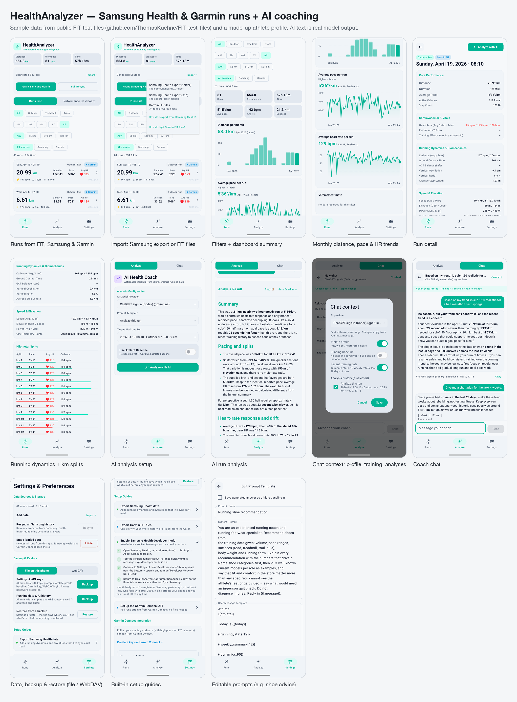

# HealthAnalyzer

An Android app that collects your runs from **Samsung Health** and **Garmin**, shows them in a dashboard, and uses the **AI provider of your choice** to analyze runs, build an athlete baseline, and chat with you like a running coach.



<sub>Screenshots use public sample data from [ThomasKuehne/FIT-test-files](https://github.com/ThomasKuehne/FIT-test-files) and a made-up athlete profile.</sub>

## Features

**Getting your runs in**
- **Samsung Health live sync** through the Samsung Health Data SDK: GPS route, per-second heart rate, speed, cadence, power, VO2max.
- **Samsung Health data export import**: adds Myotest running dynamics (ground contact and flight time, vertical oscillation, left/right asymmetry, stride regularity, leg stiffness) and sweat loss, which live sync can't read. Merges into runs you already synced.
- **Garmin Connect** through your own Personal API key: incremental sync that only downloads new activities.
- **FIT files**: single `.fit` files, Garmin "Export Original" zips, or a whole Garmin account export.
- Runs recorded by both a Galaxy Watch and a Garmin are kept once.

**Looking at them**
- Runs list with filters (type, period, distance, source).
- Performance dashboard: monthly distance, pace, heart rate and VO2max trends.
- Run detail: heart rate, running dynamics, elevation, power, and per-km splits.

**AI coaching (bring your own model)**
- Providers: any OpenAI-compatible API (OpenAI, OpenRouter, DeepSeek, Qwen, Groq, Mistral, xAI, Ollama, LM Studio…), Anthropic Claude, Google Gemini, or ChatGPT sign-in (Codex). API keys are encrypted with the Android Keystore.
- Editable prompt templates with placeholders such as `{{run}}`, `{{recent_runs:28}}`, `{{weekly_summary:12}}`, `{{running_stats:12}}`, `{{dynamics:90}}` and `{{baseline}}`. Built-in prompts: run analysis, 4-week training review, athlete baseline, running shoe rotation, race-day shoe pick.
- **Athlete baseline**: an AI-written summary of your fitness, saved and reused as context.
- **Coach chat**: multi-turn chat. For each chat you choose what the coach sees: athlete profile, baseline, recent training, and any saved analyses.

**Your data**
- Backup & restore of **settings (including API keys)** and **data (runs, analyses, chats)** to a file or a **WebDAV** folder (Nextcloud, Jianguoyun…). Backups are AES-256-GCM encrypted with a password (always, for settings).
- Erase all loaded data from Settings.
- Step-by-step setup guides in the app.

## Requirements

- Android 10 (API 29) or newer.
- **Live Samsung sync** needs a phone with Samsung Health and its *developer mode* turned on, because this app isn't a registered Samsung partner: Samsung Health → ⋮ → Settings → About Samsung Health → tap the version ~10 times → Settings → Developer mode → turn on *Developer Mode for Data Read*. Without a Samsung phone you can still use the export import, FIT files, and Garmin.
- **Garmin sync** needs your own Personal API key from [Garmin Connect](https://connect.garmin.com/app/settings/personalApiToken).
- **AI features** need your own provider account or a local model.

## Privacy

All runs, analyses and settings stay on your phone. Data leaves the phone only when you ask it to:
- an AI analysis or chat message sends the prompt (with the run data it includes) to the provider you configured;
- Garmin sync talks to Garmin Connect;
- a WebDAV backup uploads to the server you set up.

Plain-HTTP endpoints are allowed so local models on your network (e.g. Ollama) work; anything sent to an `http://` URL is unencrypted.

## Building

1. Install Android Studio (JDK 17, Android SDK 36).
2. **Samsung Health Data SDK** – not included in this repository. Download *Samsung Health Data SDK 1.1.0* from [developer.samsung.com/health/data](https://developer.samsung.com/health/data) and copy `libs/samsung-health-data-api-1.1.0.aar` to `app/libs/`. The build stops with a message if it's missing.
3. Build and install a debug version:
   ```bash
   ./gradlew installDebug
   ```
4. Run the unit tests:
   ```bash
   ./gradlew testDebugUnitTest
   ```

### Release builds

Release signing reads its settings from `~/.gradle/gradle.properties`, so no keys or passwords live in the project:

```properties
HEALTHANALYZER_STORE_FILE=/path/to/healthanalyzer-release.jks
HEALTHANALYZER_STORE_PASSWORD=…
HEALTHANALYZER_KEY_ALIAS=healthanalyzer
HEALTHANALYZER_KEY_PASSWORD=…
```

```bash
./gradlew assembleRelease   # app/build/outputs/apk/release/app-release.apk
```

Without these properties the release APK is built unsigned. Raise `versionCode` in `app/build.gradle.kts` for every build you hand out.

### GitHub Actions CI/CD

A release workflow (`.github/workflows/release.yml`) builds, signs, and attaches APKs to GitHub Releases on tag pushes (`v*`) or manual triggers (`workflow_dispatch`).

Repository secrets configured:
- `RELEASE_KEYSTORE_BASE64`: Base64-encoded release `.jks` file.
- `HEALTHANALYZER_STORE_PASSWORD`, `HEALTHANALYZER_KEY_ALIAS`, `HEALTHANALYZER_KEY_PASSWORD`: Keystore credentials.
- `SAMSUNG_SDK_DECRYPT_KEY`: Decryption key for `app/libs/samsung-health-data-api-1.1.0.aar.enc`.

## Project layout

```
app/src/main/java/com/healthanalyzer/app/
  samsung/   Samsung Health Data SDK source, export folder access
  data/      Room database, repository, FIT / Samsung export importers, Garmin Personal API
  ai/        LLM clients, prompt rendering, chat context, encrypted key storage
  backup/    Backup format, encryption, WebDAV client
  ui/        Jetpack Compose screens and view models
```

## Acknowledgements

- Sample FIT files used for testing and screenshots: [ThomasKuehne/FIT-test-files](https://github.com/ThomasKuehne/FIT-test-files).
- [Garmin FIT SDK](https://developer.garmin.com/fit/), [Samsung Health Data SDK](https://developer.samsung.com/health/data), [Anthropic Java SDK](https://github.com/anthropics/anthropic-sdk-java), OkHttp, Gson, Room, Jetpack Compose.
